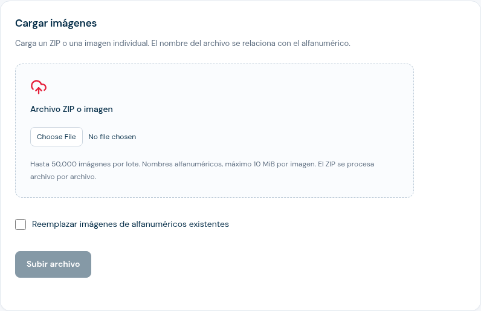

# Guía del panel de administración

**Para:** administradores de Valweb
**Objetivo:** preparar cuentas, validaciones y enlaces públicos; controlar cargas, publicación y resultados.

## Roles y responsabilidades

| Rol | Puede hacer |
| --- | --- |
| **Administrador** | Crear y suspender cuentas; invitar usuarios; crear validaciones; cargar y publicar registros e imágenes; configurar el resultado público; activar o desactivar enlaces; revisar estadísticas y ajustes generales. |
| **Cliente** | Consultar sus validaciones y estadísticas; editar textos y descripción. Puede ver los usuarios de consulta y sus validaciones asignadas. No puede cargar registros o imágenes, cambiar la publicación ni administrar usuarios. |
| **Solo consulta** | Abrir enlaces públicos protegidos que el administrador haya asignado. No tiene acceso al panel y no puede consultar otras validaciones protegidas. |

Las validaciones y los datos pertenecen a una cuenta. Al crear una validación, asigna la cuenta correcta; no se transfiere después desde la pantalla de edición.

## 1. Crear una cuenta e invitar a su equipo

1. Inicia sesión en el dominio de Valweb habilitado para tu organización.
2. Abre **Clientes → Crear cuenta**, escribe el nombre y guarda.
3. Abre **Usuarios → Invitar usuario**. Captura nombre, correo y cuenta.
4. La persona recibe un enlace de invitación válido durante 48 horas para crear su contraseña.
5. Desde **Usuarios**, puedes desactivar una cuenta individual o cerrar sus sesiones. Suspender la cuenta de cliente bloquea el acceso de sus usuarios.

## 1.1 Invitar a alguien que solo consultará enlaces protegidos

1. En **Usuarios**, selecciona **Administrar accesos de consulta**.
2. Indica nombre, correo y cuenta. Selecciona una o varias validaciones protegidas de esa cuenta.
3. La invitación vence en 48 horas. La persona crea su propia contraseña desde el enlace recibido.
4. Desde **Accesos existentes**, el administrador puede cambiar las validaciones autorizadas, reenviar invitaciones pendientes o desactivar el usuario.
5. Los clientes pueden abrir **Usuarios de consulta** en su panel para ver nombres, estado y permisos de su cuenta; no pueden invitar personas ni editar esos permisos.

La persona invitada no inicia sesión en el panel. Entra desde cada enlace protegido asignado con su correo y contraseña. Retirar una validación, desactivar al usuario o suspender la cuenta bloquea las consultas, incluso en sesiones públicas que ya estaban abiertas. Los enlaces sin protección siguen siendo públicos.

## 2. Crear una validación y reservar el enlace

1. En **Validaciones**, selecciona **Nueva validación**.
2. Elige la cuenta propietaria y completa el nombre interno, título público, instrucciones y mensajes de éxito y error. La descripción de imagen se usa como texto alternativo accesible.
3. Guarda. Valweb reserva un enlace único para la validación. Editar los textos conserva ese enlace.
4. Mantén la validación en borrador mientras preparas los registros e imágenes.

El cliente asignado podrá cambiar los textos y la descripción desde su ficha. Las cargas, la configuración del resultado y la activación quedan en manos del administrador.

## 3. Cargar y publicar registros

Explora la [simulación de carga y publicación CSV](./figuras/carga-csv/index.html) para practicar con tres registros ficticios, corregir un mapeo y comprobar por qué un lote con errores no se publica. Descarga el HTML y ábrelo en un navegador si tu visor del repositorio solo muestra el código. La simulación funciona sin conexión y no modifica datos de Valweb. Publicar una base y activar su enlace son pasos separados.

1. Abre la validación y entra en **Registros**.
2. Carga un CSV UTF-8 con encabezados. Asigna las columnas `folio` y `alfanum`; `tipo` y `otro` son opcionales.
3. Revisa el mapeo y el reporte de filas. Corrige duplicados o datos no válidos antes de publicar.
4. Elige reemplazar la base o actualizar/agregar registros según el flujo de importación.
5. Revisa el resumen y publica la base. La nueva base no queda disponible para consultas hasta publicarla.

El alfanumérico identifica la búsqueda. El folio se conserva como texto para respetar ceros iniciales, pero no sirve para buscar.

## 4. Cargar imágenes y mostrarlas en la consulta pública

1. En **Ajustes generales → Almacenamiento**, define la raíz global local o NFS. NFS debe estar montado y permitir lectura y escritura al servicio Valweb.
2. En la validación, abre **Imágenes**, selecciona el destino configurado y crea la carpeta. La ruta se separa por cuenta y validación.
3. Para cargar desde el panel, selecciona un ZIP o una imagen individual. El nombre debe coincidir con el código alfanumérico del registro: por ejemplo, `CF2026001.png` se relaciona con `CF2026001`. En lotes, cada imagen conserva su propio nombre.
4. Valweb procesa las imágenes para la consulta y las relaciona con la base publicada. Revisa el resultado del lote y confirma los reemplazos cuando se solicite.
5. Para recibir archivos por FTP, deposita los originales en `por_procesar/` dentro de la carpeta de esa validación. Vuelve al panel y usa **Procesar**; revisa el lote y confirma reemplazos pendientes. Los originales se eliminan después de publicarse correctamente.
6. Abre **Apariencia → Resultado público** y habilita **Imagen**. Antes de activar, confirma que las imágenes requeridas estén listas.
7. Prueba el enlace con un alfanumérico conocido. La imagen asociada aparecerá en el visor del resultado; revisa que corresponda al registro y que se vea correctamente en celular.

No compartas la raíz global del almacenamiento como enlace público. Las imágenes se muestran asociadas al resultado; no se publica un listado abierto del directorio.

## 5. Elegir qué verá el público y habilitar el enlace

1. En **Apariencia → Resultado público**, elige si se mostrará folio, alfanumérico, tipo, otros datos e imagen.
2. Si la organización necesita limitar el acceso, activa **Solicitar acceso con cuenta de cliente**. Solo usuarios activos de la cuenta asignada podrán consultar.
3. Revisa el resumen de disponibilidad. Para activar se necesita una cuenta activa y una base publicada con registros. Si la imagen está habilitada, deben estar listas las imágenes requeridas.
4. Selecciona **Activar validación**. La validación activa el enlace público estable.
5. Copia el enlace desde la ficha y compártelo con la persona que lo presentará o con los destinatarios.

Cambiar los campos del resultado o publicar una base nueva puede desactivar la validación para que revises el resultado antes de volver a activarla.

## 6. Revisar estadísticas y estado del servicio

- En cada ficha revisa **Registros publicados**, **Consultas**, **Encontrados** y **No encontrados**; usa **Actualizar estadísticas** para volver a consultar los datos.
- En **Estadísticas**, filtra por periodo. El administrador también puede filtrar por cuenta.
- Los registros cuentan la base publicada actual. Las consultas acumulan la actividad de la validación; no representan visitantes únicos. Se excluyen códigos con formato inválido y solicitudes bloqueadas.
- En **Ajustes generales → Sistema**, revisa la base de datos, el procesador, el espacio disponible y las cargas que esperan revisión.
- En **Notificaciones**, puedes enviar un correo de prueba. En **Operación**, puedes iniciar o reiniciar el procesador; los lotes en cola se conservan.

Si el enlace muestra «Estamos preparando tu consulta», revisa que la validación esté activa, que la cuenta esté activa y que haya una base publicada. Si se muestran imágenes, confirma que la imagen asociada exista.

## 7. Entrega al cliente y demostración

1. Prueba el enlace con un código conocido y otro inexistente.
2. Confirma que solo aparezcan los campos acordados y que la imagen corresponda al código consultado.
3. Comparte el enlace y explica que el cliente podrá mantener los textos al día y revisar estadísticas, mientras el equipo administrador mantiene las cargas y la publicación.
4. Si la consulta requiere acceso, entrega también las instrucciones de inicio de sesión al cliente.

Para presentar la experiencia desde el punto de vista de quien consulta, usa la [Guía comercial del enlace público](./ventas-enlace-publico.md).
