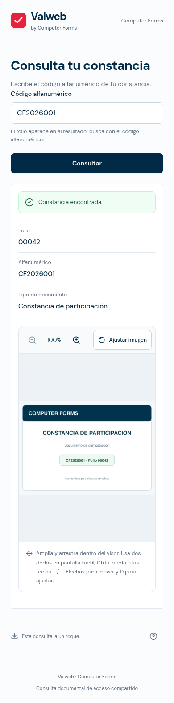

# Guía comercial del enlace público

**Para:** equipo comercial y personas que presentan Valweb
**Objetivo:** explicar el valor de una consulta documental y demostrarla en pocos minutos.

## La propuesta en una frase

Valweb convierte un enlace compartido y un código alfanumérico en una consulta documental sencilla: la persona escribe su código y ve únicamente los datos e imágenes que la organización decidió publicar.

## Qué vive la persona que consulta

1. Abre el enlace desde su celular o computadora.
2. Lee el título e instrucciones de la organización.
3. Escribe el código alfanumérico que aparece en su documento y pulsa **Consultar**.
4. Si existe el registro, ve el mensaje de confirmación, los campos habilitados y la imagen asociada en el visor cuando la organización activa esa opción.
5. Si el código no coincide con un registro, la página muestra el mensaje configurado para ese caso.

La consulta usa el **código alfanumérico**, no el folio. La organización controla qué información aparece en cada resultado.

## Demostración recomendada

Antes de la reunión, solicita a la persona administradora un enlace activo y un código de demostración que pertenezca a la base publicada.

1. Abre el enlace en un celular o reduce el navegador a una pantalla angosta.
2. Presenta el título y las instrucciones con la marca de la organización.
3. Introduce el código de demostración y muestra el resultado. Explica cómo se relaciona con el folio y con los campos visibles.
4. Abre la imagen asociada en el visor y explica que cada archivo se vincula con su registro por el código alfanumérico.
5. Prueba un código que no exista para mostrar el mensaje de respuesta.
6. Cierra con el valor operativo: el personal comparte un enlace y cada destinatario consulta su propio código, mientras el equipo mide las consultas desde el panel.

**Guion breve:** «Cada documento tiene un código alfanumérico. La persona abre este enlace, captura el código y recibe el resultado que ustedes definieron, incluida la imagen correspondiente cuando se habilita. El enlace mantiene la misma dirección mientras ustedes preparan y administran la validación».

## Qué conviene destacar

- **Acceso inmediato:** funciona desde un navegador; no hace falta instalar una aplicación para consultar.
- **Experiencia móvil:** la página y el visor están preparados para pantallas táctiles. En navegadores compatibles, la persona también puede añadir la consulta a su pantalla de inicio.
- **Contenido controlado:** la organización configura títulos, instrucciones, mensajes y campos visibles.
- **Documento asociado:** cada imagen se relaciona con el registro mediante su código alfanumérico. La persona la ve junto con su resultado, sin buscarla en una carpeta.
- **Enlace estable:** editar los textos no cambia el enlace público.
- **Seguimiento:** el panel presenta consultas, resultados encontrados y no encontrados. Son intentos de consulta, no un conteo de personas únicas.
- **Acceso configurable:** por defecto el enlace activo puede abrirse a quien lo reciba. Si la organización exige acceso de cliente, la persona debe iniciar sesión con una cuenta autorizada de esa organización.

## Cómo explicar disponibilidad y privacidad

El enlace solo realiza consultas cuando la organización habilitó la validación y publicó una base. Mientras se prepara o está desactivada, Valweb muestra una pantalla amable que indica que la consulta aún no está habilitada.

La página responde con los campos configurados para el resultado. No presenta un buscador de bases ni una lista de registros. Evita describirla como una garantía absoluta de autenticidad o como protección contra capturas de pantalla: el navegador autorizado puede mostrar los píxeles del documento.

## Preguntas frecuentes para ventas

**¿La persona necesita una cuenta?**
No, salvo que el administrador active el acceso restringido para esa validación. En ese caso, se requiere una cuenta de cliente autorizada.

**¿Puede buscar con su folio?**
La búsqueda se hace con el código alfanumérico. El folio puede mostrarse como parte del resultado.

**¿Cómo aparece la imagen del documento?**
El administrador carga la imagen asociada al código alfanumérico y habilita su visualización. Al consultar ese código, la persona puede abrir la imagen en el visor integrado.

**¿Qué pasa si el documento todavía no está listo?**
El enlace puede compartirse durante la preparación, pero la consulta se habilita cuando el administrador completa y activa la validación.

**¿Las estadísticas indican cuántas personas consultaron?**
Indican cuántas consultas válidas hubo y cuántas encontraron o no encontraron un registro. No identifican personas únicas.

## Cierre comercial

Invita a la organización a definir una validación piloto, preparar una muestra de registros e imágenes y elegir qué datos necesita mostrar. El equipo administrador carga y publica la información; el cliente puede actualizar los textos y consultar estadísticas desde su propio panel.

> Para operar el panel y preparar el enlace, consulta la [Guía del panel de administración](./panel-administracion-admin.md).
